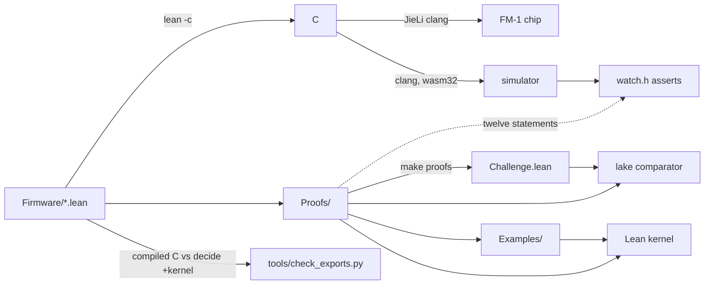

# A reviewer's tour

Fifteen minutes to judge what the 313 theorems are worth. This page says what to run, which ten statements to
read, what is not proved, and how a theorem about a Lean definition reaches the chip. The full ledger is
`docs/PROOFS.md`; the statements as Comparator sees them are `Challenge.lean`.

## How to check it yourself

Five commands, in this order. `make install` first (elan, Lean v4.35.0, the JieLi toolchain; README
"System prerequisites"). The Lake commands need Linux and `bubblewrap` for the sandbox.

| Command | What it proves | Last line when it passes |
|---|---|---|
| `lake build` | Every theorem in `Proofs/` elaborates, and `Examples/` instantiates each one on concrete inputs. `Challenge.lean` is not a default target, so no `sorry` is built. | exit 0, no `error:` line, no `declaration uses 'sorry'` warning |
| `lake comparator` | In a sandbox: `Proofs/` proves each of the 313 statements of `Challenge.lean`, and the only axioms are `propext`, `Classical.choice` and `Quot.sound` (`comparator.json`). A changed statement on either side is a mismatch, not a pass. | `Your solution is okay!`; `PARANOID=1 make comparator` adds the five external checkers, which all accept |
| `lake check` | Replays the whole build through the kernel and fails on any axiom beyond the three. The GitHub workflow does not run it; run it by hand. | `Uses axioms: propext, Classical.choice, Quot.sound`, exit 0 |
| `make test-exports` | The compiler: 354 scalar `@[export fm1_*]` functions compiled to C (Lean's backend, this computer's clang), run on random inputs, and the kernel asked by `decide +kernel` whether the definitions give the same values. 85 table readers are left out (opaque to the kernel; `make test-lean` covers them) and 30 take objects. | `export check: 354 scalar exports (85 table readers left out: opaque to the kernel, covered by make test-lean), 2124 values from the compiled C, 0 the kernel disagrees with` |
| `make test` | The web build of the real firmware in node: boot, sound, screen, LEDs, the 21 demos, every factory patch, and twelve theorems asserted on the running machine (`fw/firmware/src/watch.h`). Checks are counted and failures must be zero. | `PASS 142 factory patches, 6 s each: 0 with clipping or silence; peaks <min> to <max>` (the peaks vary); above it, one `PASS <demo>: the watched theorems hold (<n> checks)` line per demo |

`make check` is lint, the chip link check, `make test-lean`, `make test-exports` and `make comparator` in one go.

## Read these ten first

Chosen for what they rule out, not for count. For each: where it is, the statement as written, the hypotheses
and why they are there, and the line in `Examples/` that runs it on real inputs (so the hypotheses are known to
be satisfiable). Line numbers are from `grep -n "^theorem <name>" Proofs/*.lean` at the time of writing.

### 1. `run_bar_plays_every_hit` (liveness)

`Proofs/Run.lean:389`

```lean
theorem run_bar_plays_every_hit (hits steps div mask low span : Nat) (seed : UInt32) :
    let l := (Lane.make hits steps div mask low span seed).setNotes 0 100 1 0
    Lane.noteOns (l.trace (List.replicate (l.steps * l.div) .tick)) = l.hits :=
```

Rules out a lane that is safe because it is silent: over one bar of ticks a plain lane starts exactly `hits`
notes. No hypotheses: `Lane.make` clamps every knob to its range, and `setNotes 0 100 1 0` fixes the note
source to RANDOM at play chance 100, which is the only setting where "every hit" is the promise (chance below
100 drops hits on purpose). The proof reduces the bar to `euclid_hit_count`. `run_bar_plays_the_rhythm`
extends it to the rotated and automaton rhythms, `run_bar_plays_every_ratchet` to ratchets.

Example: `Examples/Sequencer.lean:99`, a 5-of-16 lane in C major.

### 2. `machine_every_note_on_has_a_note_off` (no stuck notes)

`Proofs/Machine.lean:13`

```lean
theorem machine_every_note_on_has_a_note_off (m : Machine) (quiet : m.Quiet) (laneOps : Fin 4 → List Lane.Op)
    (arpOps : List Arp.Op) :
    m.noteOns laneOps arpOps = m.noteOffs laneOps arpOps + (m.run laneOps arpOps).soundingCount ∧
      (m.run laneOps arpOps).stop.Quiet :=
```

Rules out a hanging note anywhere in the instrument: across the four lanes and the arpeggiator, after any
lists of ticks, knob changes (`Lane.Op`: `reconfigure`, `setNotes`, `setRhythm`, `learn`) and keys, note-ons
equal note-offs plus what is still sounding, and `stop` silences it. `quiet` (`Machine.Quiet`: no lane and not
the arpeggiator has a note playing) is needed because a machine that starts with a note sounding would count
a note-off without its note-on. The proof is the four lane results (`run_every_note_on_has_a_note_off`) and
the arpeggiator's, summed.

Example: `Examples/Sequencer.lean:281`, four lanes and the example arpeggiator through ticks, a reconfigure
and a key press.

### 3. `lane_note_in_scale` (in scale)

`Proofs/Lane.lean:129`

```lean
theorem lane_note_in_scale (l : Lane) (valid : Lane.Valid l) (note : Nat)
    (starts : (Lane.tick l).on = some note) : note ≤ 127 ∧ Quantizer.inScale l.mask note = true :=
```

Rules out a note outside the chosen key or above what the voices accept. `starts` names the note a tick
began. `valid` (`Spec/Lane.lean`, `Lane.Valid`) carries what the snap needs: `maskNotEmpty` and `maskSmall`
(a non-empty 12-bit scale, so the search finds a scale note), `lowFloor` (`12 ≤ low`, so the 6-semitone
search down cannot pass 0) and `spanFits` (`low + span ≤ 120`, which with a snap of at most 6 keeps the
note at or below 127). `lane_make_valid` and the `*_valid` theorems supply `valid` for every lane the
firmware builds.

Example: `Examples/Sequencer.lean:61`, note 48 from a dense lane in C major.

### 4. `euclid_is_christoffel` (music theory)

`Proofs/Euclid.lean:113`

```lean
theorem euclid_is_christoffel (hits steps k : Nat) (proper : hits < steps) :
    Euclid.hit hits steps k = Euclid.christoffel hits steps k :=
```

Rules out the firmware's rhythm being a private construction: `Euclid.hit` (the floor-function pattern the
lane plays) is, step for step, the lower Christoffel word of slope `hits / steps` in Berstel's form
(`Spec/Euclid.lean`), so the published results on those words apply. `proper` is needed because at
`hits = steps` the Christoffel test `(k + 1) * hits % steps < k * hits % steps` is never true while the
pattern is every step. `euclid_bjorklund_is_rotation` ties the same pattern to Bjorklund's algorithm.

Example: `Examples/Sequencer.lean:150`, step 7 of 5-in-16.

### 5. `harmony_complement_interval_content` (music theory)

`Proofs/Harmony.lean:311`

```lean
theorem harmony_complement_interval_content (n d : Nat) (positive : 0 < n) (S : Nat → Bool) :
    Harmony.pairs n d (fun k => !S k) + 2 * Harmony.count n S = Harmony.pairs n d S + n :=
```

Rules out COMPL (the lane that plays only the notes outside the key) having a different interval content
from the key: for any cycle `Z_n` and any set `S`, the ordered count of pairs at distance `d` in the
complement is the count in `S` plus `n - 2 |S|`, Lewin's general form of Babbitt's hexachord theorem.
`positive` is needed because the proof turns the cycle by `d` modulo `n`. `harmony_hexachord_theorem` is the
`n = 12`, `|S| = 6` case checked over all 4096 masks.

Example: `Examples/Sequencer.lean:234`, the major scale mask at distance 5.

### 6. `tonnetz_walks_are_cycles` (music theory)

`Proofs/Tonnetz.lean:63`

```lean
theorem tonnetz_walks_are_cycles (start : Fin 24) :
    ((List.range 24).map (Tonnetz.walk 0 start)).Nodup ∧ Tonnetz.walk 0 start 24 = start ∧
      ((List.range 6).map (Tonnetz.walk 1 start)).Nodup ∧ Tonnetz.walk 1 start 6 = start ∧
      ((List.range 8).map (Tonnetz.walk 2 start)).Nodup ∧ Tonnetz.walk 2 start 8 = start :=
```

Rules out a chord walk that never comes home or repeats a triad early: from any of the 24 triads, WALK LR
visits all 24 once and returns after 24 moves, WALK PL is a 6-cycle, WALK PR an 8-cycle. The one hypothesis
is the start; the proof is `decide +kernel` over all 24. `tonnetz_group_has_order_24` and
`tonnetz_group_is_dihedral` are the group theory behind it.

Example: `Examples/Sequencer.lean:252`, from triad 0.

### 7. `mix_machine_sample_bounded` (DSP)

`Proofs/Mix.lean:266`

```lean
theorem mix_machine_sample_bounded (voices : List Int32) (echo delayGain wet reverbGain : Int32)
    (atMostSix : voices.length ≤ 6) (eachBounded : ∀ s ∈ voices, s.toInt.natAbs ≤ 65024)
    (echoStored : echo.toInt.natAbs ≤ 32768) (delayInRange : 0 ≤ delayGain.toInt ∧ delayGain.toInt ≤ 65500)
    (wetBounded : wet.toInt.natAbs ≤ 2 ^ 29 + 2 ^ 21)
    (reverbInRange : 0 ≤ reverbGain.toInt ∧ reverbGain.toInt ≤ 65500) :
    let dry := voices.foldl (· + ·) 0
    let withDelay := Mix.mixIn dry echo delayGain
    let out := Mix.mixIn withDelay wet reverbGain
    withDelay.toInt = dry.toInt + echo.toInt * delayGain.toInt / 32768 ∧
      withDelay.toInt.natAbs ≤ 455680 ∧
      out.toInt.natAbs ≤ 524287 ∧ out.toInt.natAbs * 4088 < 2 ^ 31 ∧
      (out.toInt.natAbs < 524287 → out.toInt = withDelay.toInt + wet.toInt * reverbGain.toInt / 32768) :=
```

Rules out a wrapped sample at the master stage: the whole `app_audio` path (six voices, the delay return,
the reverb return) is exact 32-bit arithmetic clipped at 524287, and that times the master gain (at most
4088, `platform.c`) fits 32 bits. Each hypothesis is another theorem's conclusion: `eachBounded` is
`mix_voice_sample_never_wraps`, `echoStored` is a 16-bit delay-line sample (`delay_store_saturates`),
`wetBounded` is `reverb_wet_never_overflows`, and the two gains are at most twice the largest RETURN
setting. `atMostSix` is the voice count. The watch asserts this one on the running simulator.

Example: `Examples/Voices.lean:526`, three voices, an echo and a wet sample at unity gains.

### 8. `fm_sine_bounded` (DSP)

`Proofs/Fm.lean:43`

```lean
theorem fm_sine_bounded (phase : UInt32) : (Fm.sineAt phase).toInt.natAbs ≤ 32767 :=
```

Rules out the FM voice's sine (a polynomial, not a table) handing a modulator or the mix more than full
scale at any of the 2^32 phases. No hypotheses: the quarter polynomial is held at 32767 by a `min`
(`Fm.quarter`) and the other three quarters are its mirror and sign. That the hold is not doing the work is
`fm_sine_exact_at_quarters` and `fm_sine_continuous`, which check the polynomial at every position.

Example: `Examples/Voices.lean:89`, phase `0x12345678`.

### 9. `drum_noise_period` (DSP)

`Proofs/Drum.lean:102`

```lean
theorem drum_noise_period :
    Drum.lfsrAfter 1 65535 = 1 ∧ ∀ k, 0 < k → k < 65535 → Drum.lfsrAfter 1 k ≠ 1 :=
```

Rules out a short loop in the 808's noise: the 16-bit register from state 1 returns to 1 after exactly 65535
steps and not before, so the taps are a primitive polynomial and the noise behind the kick's click, the
snare, the clap and the toms repeats only every 1.5 s. No hypotheses; the kernel walks the orbit
(`decide +kernel`, `maxRecDepth` raised for the depth, one of three such files). `drum_noise_never_dies`
says a nonzero state never steps to zero, which is why the glue seeds with 1 and never resets.

Example: `Examples/Voices.lean:168`.

### 10. `patch_decode_encode_round_trip` (the patch format)

`Proofs/Patch.lean:16`

```lean
theorem patch_decode_encode_round_trip (p : Patch) (fits : p.Fits) :
    Patch.decode (Patch.encode p) = some p :=
```

Rules out a user slot that loads back as something other than what was saved. `fits` (`Patch.Fits`,
`Firmware/Patch.lean`: tempo 40 to 240, key below 12, every setting in its knob range, four lanes that fit)
is needed because the format is one byte a field; a value past a byte would not survive. `presets_all_fit`
discharges it for the 142 factory patches and `patch_decode_only_fits` for anything a slot loads, so a
decoded patch always fits. The watch asserts the round trip on the running simulator whenever a patch is encoded.

Example: `Examples/Sequencer.lean:359`, the first factory preset.

Also worth a look: `filter_states_stay_bounded` (`Proofs/Filter.lean:106`), the bound on the state-variable
filter every sound passes through, and `run_clock_never_drifts`, which keeps lanes at different speeds in phase.

## What is not proved

From the README, "What is trusted":

- The statements themselves: `Lane.Valid`, `Patch.Fits`, `Machine`, `Reverb.loop` and the rest of `Spec/` say
  what is promised; `Examples/` shows each is satisfiable on real inputs, nothing shows they are the right thing
  to promise.
- `rt/lean_rt.c`, the Lean runtime for the chip (`docs/LEAN-ON-CHIP.md`).
- Lean's compiler to C, and JieLi's clang from C to the chip.
- The C left in `voices/` and `fx/`: Braids' per-block setup, the delay memories, and the loops that call the
  Lean steps (`docs/LEAN-ENGINES.md`, `docs/FX.md`). `make test-lean` checks the reverb glue calls the steps in
  the order `Reverb.loop` says, over 20000 samples, and compares the result against Clouds.
- Dinghy (`fw/`: platform, drivers, the update path) and `fw/firmware/src/dinghy.c`, which calls the Lean. The
  master gain and clip in `platform.c`.
- The hardware, and `web/web_host.c` in the simulator.
- 34 `@[extern] opaque` table readers for Braids' wavetables and lookup tables. Their only contract is the return
  type, so a theorem that mentions one holds whatever they return; the caller proves the index is in bounds
  (`*_reads_inside_*`), and those engine steps are tested against the C++.
- Five more readers (`incrementTable`, `Percussion.cutoffTable`, `rateTable`, `vowelAmplitudeAt`, `tableSteps`)
  are `@[extern] def`s whose Lean bodies are copies of Braids' tables (`Firmware/BraidsData.lean`, generated by
  `tools/gen_tables.py`, kept in step by `make lint`). The `braids_data_*` theorems are about the copies; that the
  C accessor reads the same table is trusted.

From `docs/LEAN-ENGINES.md`, "What is not done":

- The proofs about the engines cover arithmetic facts, not sound. The guarantee that the engines sound like
  Braids is the differential test (`make test-lean`). The Lean differs from Braids in two places: the bowed
  string's body filter state is held within 2^18 (`Physical.bodyState`, never reached in the test), and the
  flute's body filter note is held at 127 (`PhysicalSetup.flutedNote`), where Braids reads past its 128-entry
  table.
- Samples that Braids itself can overflow are not proved: the kick's low-pass step, the blown pipe's reed
  product and the state-variable filter's cutoff times high-pass can pass 32 bits at the extremes of their
  clipped states, and the clocked noise's quantized value can pass 16 bits. The Lean matches Braids there.
- Indexes that depend on C data are not proved: the question mark's position in its code table (bounded by the
  stop symbol in the data); the wave line's wave after the scan, which reads one past Braids' 64-entry line at the
  top of the parameter's range (Braids' own overrun, kept so the output matches); the wave numbers the selection
  tables hold (`wavetables_setup_wave_in_bank` takes a number up to 255).
- The chip's CPU cost of the Lean path is unmeasured; on x86 the analog oscillators run at about 1.3 times the
  original's time per sample.

Also: no `axiom`, no `native_decide` (`make lint` refuses both); `maxRecDepth` is raised in three proof files
for big `decide`s, `maxHeartbeats` never.

## How the statements connect to the chip

The theorems are about the Lean in `Firmware/`. That same Lean is compiled to C by Lean's backend and to the
chip by JieLi's clang; both compilers are trusted. Two tests reach across that gap: `make test-exports` runs
the compiled C and asks the kernel whether the definitions give the same values, and `watch.h` asserts twelve
of the statements on the running firmware (simulator and host builds, not the chip) at the point `dinghy.c`
takes the Lean's answer.



What each arrow leaves trusted is the list above. What a reviewer can observe without trusting anything but
the kernel: `lake check` and `lake comparator`. What needs the compilers trusted: everything that makes a sound.
